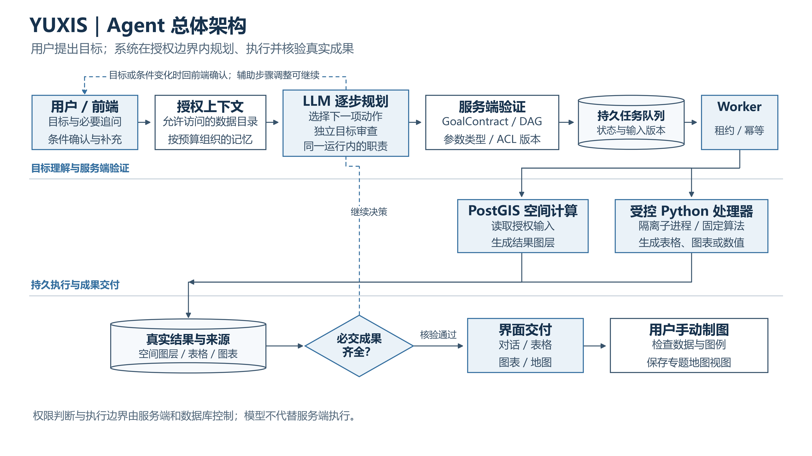
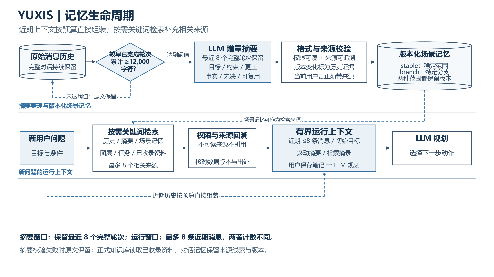
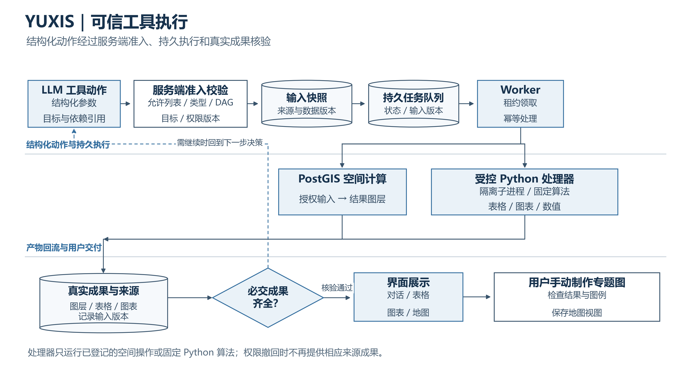
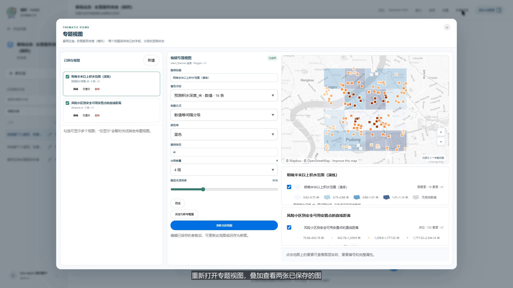
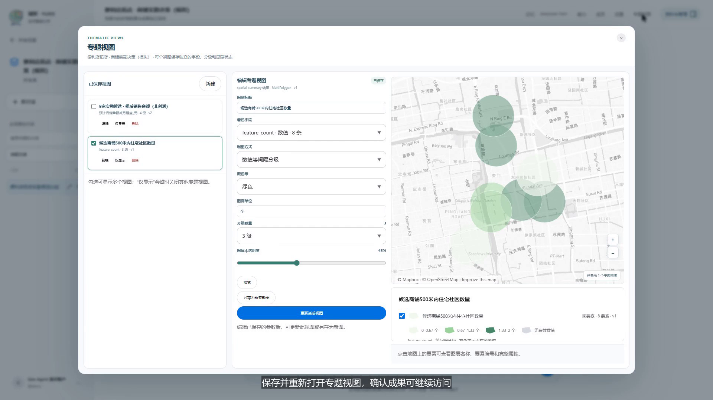
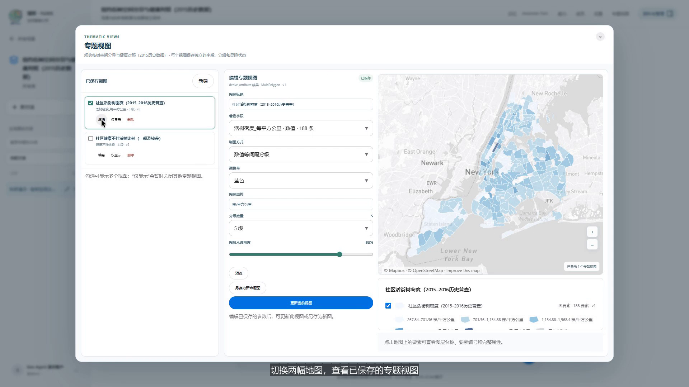
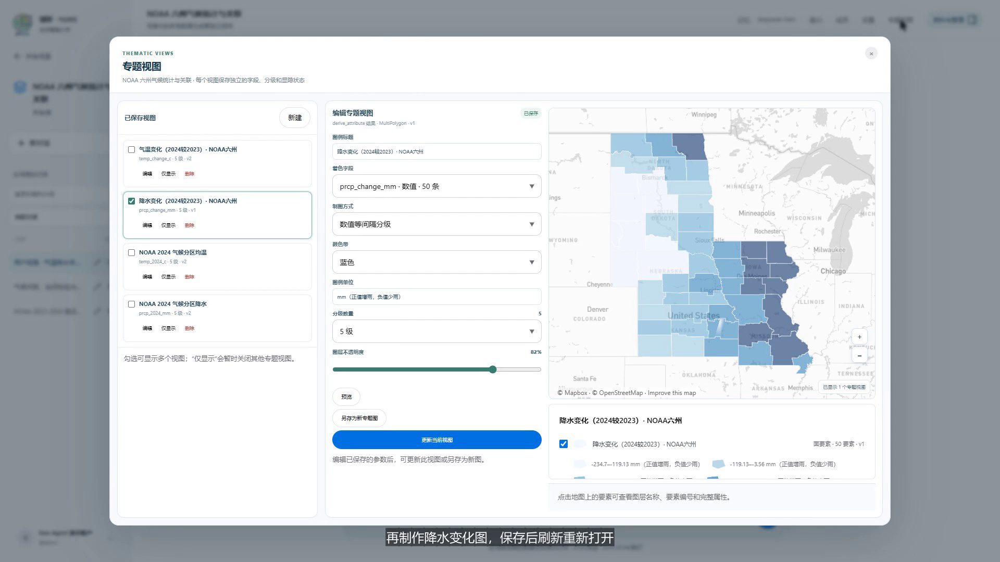

# YUXIS · 域析空间智能分析案例

YUXIS 把日常业务与研究问题接入空间数据分析流程：前端先确认必要条件，Agent 从当前场景可用的数据中选择工具并执行分析，用户查看结果后手动制作专题图。本网站介绍四个案例，并提供演示环境录制的视频和精选成果图。

**[打开案例展示网站](https://yxywindows.github.io/YUXIS-Showcase/)** · [暴雨应急](https://yxywindows.github.io/YUXIS-Showcase/#storm) · [便利店拓店](https://yxywindows.github.io/YUXIS-Showcase/#store) · [纽约街树](https://yxywindows.github.io/YUXIS-Showcase/#nyc) · [NOAA 气候](https://yxywindows.github.io/YUXIS-Showcase/#noaa)

## 架构与记忆

在[案例网站的架构与记忆板块](https://yxywindows.github.io/YUXIS-Showcase/#architecture)查看三张流程图，或阅读[架构与记忆说明](docs/architecture.md)：

- [Agent 总体架构高清 PNG](assets/diagrams/agent-architecture.png) · [同画 SVG](assets/diagrams/agent-architecture.svg)：目标澄清、规划、服务端验证、持久执行与成果交付。

- [记忆生命周期高清 PNG](assets/diagrams/memory-lifecycle.png) · [同画 SVG](assets/diagrams/memory-lifecycle.svg)：摘要与来源校验、版本化记忆、关键词检索和有界上下文。

- [可信工具执行高清 PNG](assets/diagrams/trusted-execution.png) · [同画 SVG](assets/diagrams/trusted-execution.svg)：允许列表、权限与版本检查、持久队列、固定处理器和结果核验。

## 四段演示

| 案例 | 类型 | 时长 | 封面 | 视频 | 中文字幕 | 页面介绍 |
| --- | --- | ---: | --- | --- | --- | --- |
| 暴雨应急与安置服务排查 | 模拟演练 | 3:34 |  | [观看/下载 1080p MP4](media/01-storm-edited.mp4) | [SRT](media/01-storm-edited.srt) | [场景与边界](https://yxywindows.github.io/YUXIS-Showcase/#storm) |
| 便利店拓店与实勘决策 | 模拟演练 | 3:51 |  | [观看/下载 1080p MP4](media/02-store-edited.mp4) | [SRT](media/02-store-edited.srt) | [场景与边界](https://yxywindows.github.io/YUXIS-Showcase/#store) |
| 纽约街树空间分异与健康对照 | 2015–2016 历史资料 | 3:26 |  | [观看/下载 1080p MP4](media/03-nyc-urban-edited.mp4) | [SRT](media/03-nyc-urban-edited.srt) | [场景与边界](https://yxywindows.github.io/YUXIS-Showcase/#nyc) |
| NOAA 中部六州气候年际变化 | 2023–2024 历史资料 | 2:27 |  | [观看/下载 1080p MP4](media/04-noaa-user-edited.mp4) | [SRT](media/04-noaa-user-edited.srt) | [场景与边界](https://yxywindows.github.io/YUXIS-Showcase/#noaa) |

视频为 1920×1080、25 fps 中文字幕实录，保留原速，仅剪去等待片段。页面提供原生播放控件和 MP4/SRT 下载。封面、两张专题图及交互过程截图可在[案例页面](https://yxywindows.github.io/YUXIS-Showcase/)查看。

## 案例范围

- **暴雨应急**：8 类、1,560 个模拟要素。演练识别 16 个积水风险单元、152 个受影响小区，其中 131 个到合格安置点的直线距离超过 800 米。容量只用于资格筛选，不分配人口；直线距离不是路网或步行路线。
- **便利店拓店**：7 类、2,068 个模拟要素。待租铺位从 160 家初筛到 59 家、避让后 46 家，再列出 8 家实勘候选。预计月销售额减月租金称“租后销售余额”，不等于利润。
- **纽约街树**：官方 2015–2016 历史普查 683,788 条记录汇总后，匹配 2010 年边界；导入 195 个社区计数面与 5 个行政区参照，分析 188 个普通社区。Moran 推断使用 180 个有邻接社区，I≈0.2508、p=0.001；多重校正后的局部显著聚集为 0。最低 10 个是探索候选，不是显著低值区。
- **NOAA 气候**：美国中部六州 50 个气候分区比较 2023 与 2024。50 个分区升温，17 个降水减少，平均温差 +0.723 °C、平均降水差 +60.716 mm，Pearson r=−0.5043、R²=0.2543。两年比较不能代表长期趋势或因果；人工复核指出毫米与摄氏度的离散程度不可直接比较。

## 内容说明

本仓库只包含静态介绍页和精选展示媒体，可由 GitHub Pages 托管。应用业务代码独立管理，不在此仓库发布。本网站不包含原始运行记录、账号资料、凭据、数据库、GeoJSON 数据包、私有项目地址或在线试用入口。

前两案为明确标记的模拟演练，不代表现实预测、实地商业调查或财务结论。纽约街树普查和 NOAA 气候资料均有明确年份；数据时点、统计口径与方法限制了可得结论。专题图在分析结果完成后由人检查并手动制作。网站内容是演示环境实录，实际部署版本可能不同。

## 官方数据来源

- 纽约市 [2015 Street Tree Census](https://data.cityofnewyork.us/Environment/2015-Street-Tree-Census-Tree-Data/uvpi-gqnh/about_data) · [Data.gov 数据目录](https://catalog.data.gov/dataset/2015-street-tree-census-tree-data) · [NYC DCP 2010 NTA 边界](https://services5.arcgis.com/GfwWNkhOj9bNBqoJ/ArcGIS/rest/services/NYC_Neighborhood_Tabulation_Areas_2010/FeatureServer/0)
- NOAA NCEI [气候分区边界](https://www.ncei.noaa.gov/monitoring-content/data/us/climdiv/monthly/current/CONUS_CLIMATE_DIVISIONS.shp.zip) · [月降水发布版](https://www.ncei.noaa.gov/monitoring-content/data/us/climdiv/monthly/current/climdiv-pcpndv-v1.0.0-20261006) · [月气温发布版](https://www.ncei.noaa.gov/monitoring-content/data/us/climdiv/monthly/current/climdiv-tmpcdv-v1.0.0-20261006)
